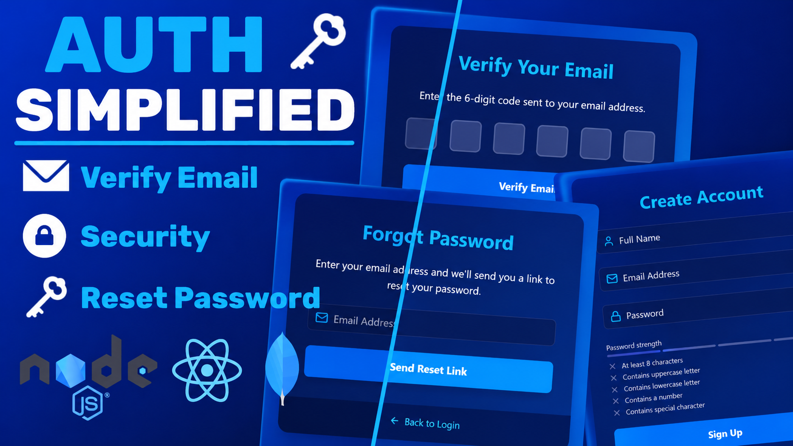

# Secure Auth MERN

A full-stack MERN authentication app with account signup, login, protected routes, email verification, password reset, JWT cookies, MongoDB persistence, and SMTP email delivery.



## Features

- React + Vite frontend with protected auth routes
- Express API with JWT authentication stored in HTTP-only cookies
- MongoDB user storage through Mongoose
- Email verification flow
- Forgot password and reset password flow
- SMTP mail delivery through Nodemailer
- Password visibility toggles on password fields
- Windows-friendly development commands

## Tech Stack

- React 18
- Vite
- Zustand
- Tailwind CSS
- Express
- MongoDB + Mongoose
- JWT
- Nodemailer SMTP

## Environment Variables

Create a `.env` file in the project root:

```env
MONGO_URI=your_mongodb_connection_string
PORT=5000
JWT_SECRET=your_jwt_secret
NODE_ENV=development

# Auth Mail
MAIL_HOST=smtp.gmail.com
MAIL_PORT=587
MAIL_USERNAME=your_email@gmail.com
MAIL_PASSWORD=your_google_app_password
MAIL_SMTP_AUTH=true
MAIL_SMTP_STARTTLS=true
AUTH_MAIL_FROM_ADDRESS=your_email@gmail.com

CLIENT_URL=http://localhost:5173
```

For Gmail SMTP, use a Google App Password. Do not use your normal Gmail password.

## Install

```powershell
npm install
npm install --prefix frontend
```

## Run Locally

Start the backend:

```powershell
npm run dev
```

Start the frontend in another terminal:

```powershell
cd frontend
npm run dev
```

Open:

```text
http://localhost:5173/login
```

## Build

```powershell
npm run build
```

## API Routes

- `POST /api/auth/signup`
- `POST /api/auth/verify-email`
- `POST /api/auth/login`
- `POST /api/auth/logout`
- `GET /api/auth/check-auth`
- `POST /api/auth/forgot-password`
- `POST /api/auth/reset-password/:token`

## Security Notes

- Keep `.env` private. It is ignored by Git.
- Rotate credentials if they were shared publicly.
- Use strong `JWT_SECRET` values in production.
- Use HTTPS in production so secure cookies can be enabled safely.
